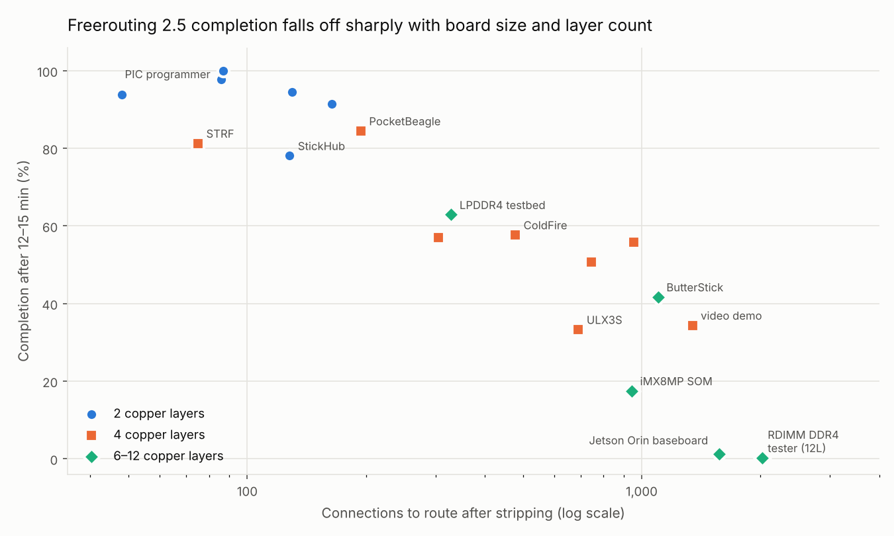

# PCB Design Lab

A self-study and benchmarking repo for getting from "my first board" to genuinely hard PCBs — DDR memory, multi-gigabit serial, RF, high-current power, HDI — using only free and open resources.

| Folder | What's inside |
|---|---|
| [`curriculum/`](curriculum/) | [MIT OpenCourseWare map](curriculum/mit-ocw.md) (28 courses/resources sorted by what they teach a board designer) and a [5-stage learning path](curriculum/learning-path.md) |
| [`docs/`](docs/) | [Design handbook](docs/01-design-handbook.md) (return paths, stackups, diff pairs, interface cheat-sheet, BGA escape, DFM), [KiCad workflow](docs/02-kicad-workflow.md), [EAGLE end-of-life & migration](docs/03-eagle-migration.md) |
| [`references/`](references/) | [Free learning resources and open-source EDA tools](references/open-resources.md), [open-source hard boards to study](references/hard-open-boards.md) |
| [`challenges/`](challenges/) | [10 graded hard-board challenges](challenges/README.md) from a 24-bit ADC to a Jetson-class baseboard, each with pass/fail criteria and a constraint file |
| [`benchmark/`](benchmark/) | [Strip-and-reroute autorouter benchmark](benchmark/README.md) on real KiCad boards, graded by KiCad DRC — [results](benchmark/RESULTS.md) |
| [`tools/`](tools/) | [`check_constraints.py`](tools/check_constraints.py) — scripted high-speed rule checker (diff-pair skew, length groups, vias, layers) |
| [`bounties/`](bounties/) | [Live list of PCB contests, bounties, grants and commission markets](bounties/README.md) (snapshot 2026-10-23) |

## Start here

1. Read the [learning path](curriculum/learning-path.md) and pick your stage.
2. Install KiCad and skim the [handbook](docs/01-design-handbook.md).
3. Do challenge [C01](challenges/specs/C01-precision-adc.md), grade it with [`tools/check_constraints.py`](tools/check_constraints.py), and keep going.

## Benchmark headline

We stripped the routing from 19 real open-source boards and let Freerouting (the main free autorouter) redo it, grading the result with KiCad's own DRC. Full write-up: **[benchmark/RESULTS.md](benchmark/RESULTS.md)**.

- 2-layer boards: 78–100 % routed in under 4 minutes.
- Modern 6–12 layer boards (DDR, fine-pitch BGA, dozens of diff pairs): 0.2–63 % in 15 minutes.
- The router's own "done" count is optimistic — it chops up ground pours and strands pads that KiCad then flags.
- Freerouting 2.5's default neck-down breaks minimum-width rules; pass `--router.automatic_neckdown=false`.

## Licences

- Original text in this repo: CC BY-SA 4.0. Scripts: MIT.
- This repo links to MIT OpenCourseWare (CC BY-NC-SA 4.0) and does not mirror it.
- Benchmark boards are fetched from their own repositories at run time and keep their own licences; none are redistributed here.
