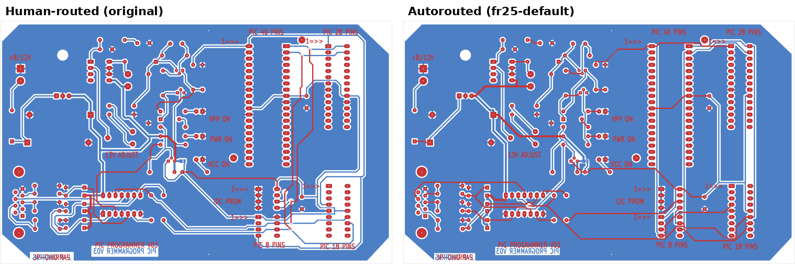
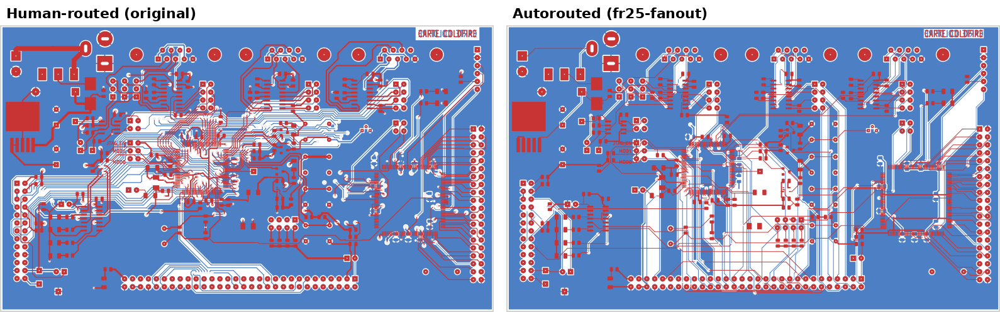
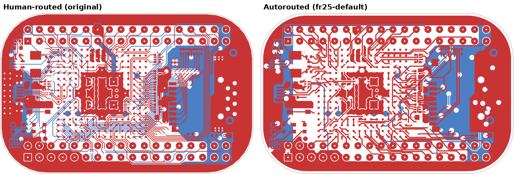
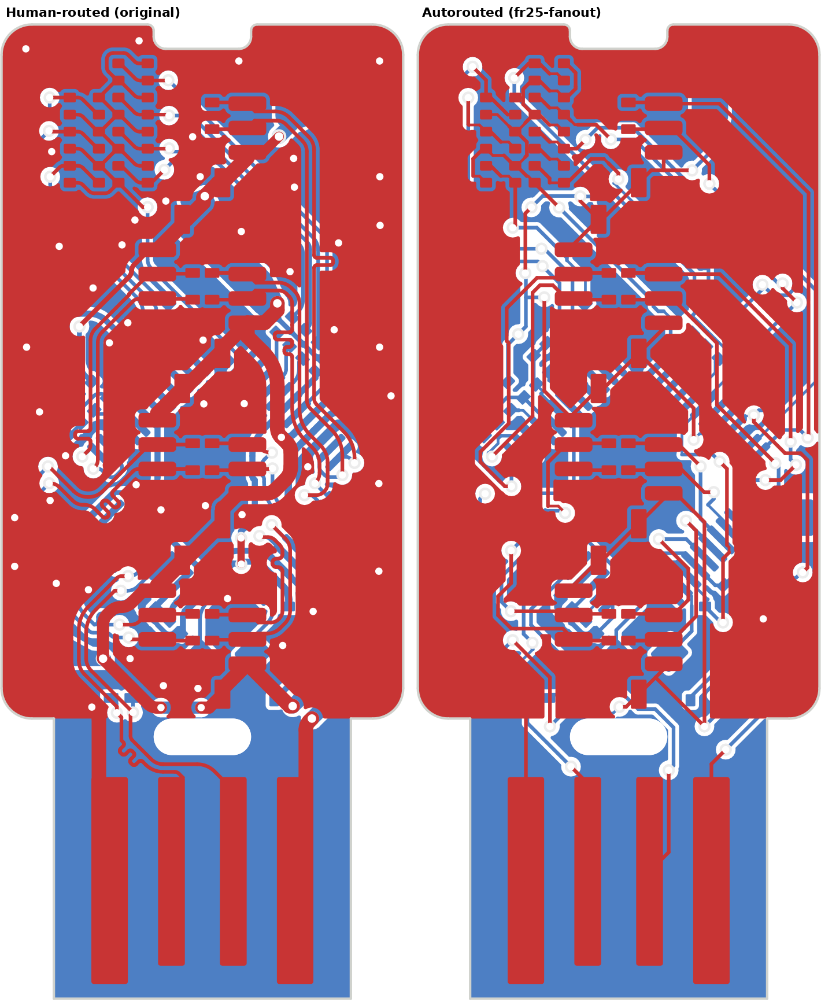

# Benchmark results — Freerouting vs. human layouts on 19 real boards

Run 2026-10-23 on a 2-vCPU / 7 GB cloud VM, KiCad 7.0.11, Freerouting 2.5.0 and 2.1.0. Method and scripts: [README.md](README.md). Raw data: [`results/results.csv`](results/results.csv), [`results/runs.jsonl`](results/runs.jsonl).

**Completion** is measured by KiCad's connectivity engine after importing the autorouter's copper and refilling zones — not by the router's own report. Placement is the human's; only routing is re-done.

## Headline

| | |
|---|---|
| **Simple 2-layer boards** | Freerouting finishes in **under 4 minutes** with **78–100 % completion**, fewer vias and 11–28 % less copper than the human — because it ignores everything except connectivity and clearance. |
| **Dense 4-layer boards** | Completion falls to **33–85 %** within a 15-minute budget. |
| **Modern 6–12 layer boards** (DDR, fine-pitch BGA, ~100 diff pairs) | **0.2–63 %** in 15 minutes. On the Jetson Orin baseboard and the 12-layer DDR4 tester it barely gets started (1.2 % and 0.2 %). |
| **Router vs. reality** | The router's own "unrouted" count is optimistic. It treats copper pours as always-connected planes, but its tracks chop those pours up; after KiCad refills them, pads it considered connected (mostly GND) are isolated. StickHub: router says 2–8 left, KiCad finds 18–28. |
| **Freerouting 2.5 regression** | 2.5's default *automatic neck-down* draws traces narrower than the board's minimum width near pins (0.112 mm on a 0.15 mm board), creating up to ~200 track-width DRC errors per board. **`--router.automatic_neckdown=false` fixes it** (StickHub: 111 → 7 new DRC errors, and completion rose from 78 % to 86 %). |

## Per-board results (Freerouting 2.5.0, default settings, 12–15 min budget)

| Board | Cu layers | Pads | Connections to route | Completion | Left unrouted | Vias human → auto | Copper human → auto (m) | Time | Router state |
|---|---|---|---|---|---|---|---|---|---|
| KiCad demo: complex hierarchy | 2 | 165 | 87 | **100.0 %** | 0 | 0 → 0 | 1.27 → 1.04 | 0.2 min | done |
| KiCad demo: PIC programmer | 2 | 247 | 86 | 97.7 % | 2 | 6 → 1 | 1.75 → 1.55 | 0.8 min | done |
| KiCad demo: XC95108 CPLD board | 2 | 282 | 130 | 94.6 % | 7 | 12 → 2 | 2.95 → 2.40 | 0.6 min | done |
| KiCad demo: Xilinx probe | 2 | 108 | 48 | 93.8 % | 3 | 3 → 3 | 0.64 → 0.56 | 0.3 min | done |
| KiCad demo: interf_u | 2 | 379 | 164 | 91.5 % | 14 | 84 → 29 | 5.10 → 4.46 | 3.3 min | done |
| PocketBeagle (OSD3358 SiP BGA) | 4 | 486 | 194 | 84.5 % | 30 | 171 → 136 | 2.56 → 2.31 | 4.0 min | done |
| STRF (RF/MCU, 0.5 mm pitch) | 4 | 166 | 75 | 81.3 % | 14 | 70 → 17 | 0.29 → 0.18 | 1.5 min | done |
| KiCad demo: StickHub USB hub | 2 | 278 | 128 | 78.1 % | 28 | 87 → 45 | 0.74 → 0.54 | 3.5 min | done |
| Antmicro LPDDR4 testbed | 6 | 677 | 329 | 62.9 % | 122 | 248 → 152 | 0.96 → 0.61 | 15.3 min | timed out |
| KiCad demo: ColdFire + Xilinx dev kit | 4 | 825 | 478 | 57.7 % | 202 | 253 → 108 | 9.41 → 5.74 | 12.2 min | timed out |
| BeagleConnect Freedom (sub-GHz + 2.4 GHz) | 4 | 727 | 305 | 57.0 % | 131 | 399 → 82 | 2.79 → 1.07 | 15.2 min | timed out |
| HackRF One | 4 | 1639 | 954 | 55.8 % | 422 | 498 → 0 ¹ | 9.05 → 2.60 | 15.3 min | timed out |
| Glasgow revC3 (iCE40 BGA) | 4 | 1149 | 745 | 50.7 % | 367 | 416 → 84 | 4.44 → 1.88 | 15.2 min | timed out |
| ButterStick (ECP5 + 2× DDR3L) | 8 | 1639 | 1101 | 41.7 % | 642 | 1163 → 168 | 9.66 → 2.28 | 15.2 min | timed out |
| KiCad demo: video (FPGA + SDRAM) | 4 | 2238 | 1345 | 34.4 % | 882 | 808 → 366 | 35.47 → 4.91 | 12.6 min | timed out |
| ULX3S (ECP5 BGA-381 on 4 layers) | 4 | 1177 | 691 | 33.3 % | 461 | 554 → 110 | 8.81 → 1.60 | 15.5 min | timed out |
| Olimex iMX8MP SOM (0.5 mm FCBGA) | 6 | 2332 | 944 | 17.5 % | 779 | 988 → 135 | 13.04 → 0.80 | 15.8 min | timed out |
| Antmicro Jetson Orin baseboard | 8 | 2689 | 1572 | 1.2 % | 1553 | 1267 → 5 | 18.91 → 0.03 | 16.6 min | timed out |
| Antmicro RDIMM DDR4 tester | 12 | 3419 | 2021 | 0.2 % | 2017 | 2483 → 1 | 25.86 → 0.01 | 17.1 min | timed out |

¹ Freerouting placed no vias on HackRF even though the DSN defines a 0.457/0.254 mm via; worth investigating before drawing conclusions from that row.

Not run: **ThunderScope FPGA module** — KiCad 7.0.11 hits an internal coordinate-overflow trap on this board during preparation; it needs KiCad 8+.

## Router configurations compared (KiCad demo boards + four GitHub boards)

| Board | 2.5 default | 2.5 + fan-out | 2.5 no neck-down | 2.1 default |
|---|---|---|---|---|
| PIC programmer | 97.7 % · 0.8 min | 97.7 % · 0.3 min | — | 96.5 % · 6.4 min |
| StickHub | 78.1 % · 111 new DRC | 82.0 % · 131 new DRC | **85.9 % · 7 new DRC** | 81.2 % · 3 new DRC |
| Xilinx probe | 93.8 % | 95.8 % | — | **100 %** |
| interf_u | 91.5 % | **95.1 %** | — | 92.1 % |
| XC95108 | 94.6 % | 93.1 % | 94.6 % | 93.1 % |
| complex hierarchy | **100 %** · 0.2 min | 97.7 % | — | 86.2 % · 12.1 min (timed out) |
| ColdFire | 57.7 % | 68.8 % | — | **69.0 %** |
| video | 34.4 % | 32.1 % | — | no output in 22 min |
| STRF | 81.3 % · 34 new DRC | — | 81.3 % · **9 new DRC** | — |
| PocketBeagle | 84.5 % | — | **86.6 %** | — |

Takeaways:

- **Fan-out mode** (pre-routing SMD pads to vias) helps on denser boards (ColdFire +11 points, interf_u +3.6) but leaves dangling vias behind when it can't finish.
- **2.5 vs 2.1:** 2.5 is dramatically faster on small boards (complex hierarchy: 0.2 min vs. a 12-minute timeout) and is the only version that produced output on the video board, but its default neck-down creates width violations that 2.1 didn't.
- **Turn neck-down off** unless your fab rules allow the narrower traces.

## Comparison with published AI-router numbers

DeepPCB published a comparison against Quilter on three open boards ([write-up](https://deeppcb.ai/deeppcb-vs-quilter-open-source-routing-compared-2026/)). We ran Freerouting on the same three:

| Board | DeepPCB (vendor-reported) | Quilter (as reported by DeepPCB) | Freerouting 2.5 (this benchmark) |
|---|---|---|---|
| STRF | 99 % · 29 vias | 94 % · 58 vias | 81.3 % · 17 vias |
| PocketBeagle | 96 % · 135 vias | 82 % · 163 vias | 84.5–86.6 % · 133–136 vias |
| BeagleConnect Freedom | 97 % · 191 vias | 87 % · 235 vias | 57.0 % · 82 vias (15-min cap) |

**Not apples to apples.** The vendor numbers count airwires and were measured by DeepPCB on its own setup; we count KiCad connectivity after zone refill, on KiCad-7-readable revisions of the boards, with a 15-minute cap. Treat this as a rough positioning: free Freerouting is competitive with Quilter on mid-size 4-layer boards and falls well behind on larger ones within a short budget.

## What this means for designing hard boards

1. **Autorouters are for the boring remainder.** Hand-route power, every high-speed and sensitive net, and the BGA escape, lock them, then let the autorouter finish the slow GPIO/LED/config nets. That's how the human designs above got to 100 %.
2. **Never trust the router's own completion figure** — refill zones in KiCad and run DRC with connectivity checks. Ground pours are the usual casualty.
3. **Route planes deliberately.** Add stitching vias and short stubs to GND/power pads before autorouting so chopped pours can't strand them.
4. **Constraint-aware routing (impedance, length matching, return paths) is not in any free router.** Use [`tools/check_constraints.py`](../tools/check_constraints.py) to see how far an autorouted board is from passing.
5. **Placement dominates.** These runs reuse expert placements. On your own boards, iterate placement before blaming the router.

## Images

Human-routed original (left) vs. autorouted (right), top and bottom copper.

**PIC programmer** — the easy case: routed in under a minute with fewer vias.

**ColdFire dev kit** — 4 layers, 69 % after 12 minutes; note the long parallel runs the human avoided.

**PocketBeagle** — SiP BGA on 4 layers.

**StickHub** — 2-layer USB hub; ground pour fragmentation is visible on the right.

## Caveats

- Budgets were 12 min (KiCad demos) and 15 min (GitHub boards) on 2 slow vCPUs with two jobs in parallel. Freerouting is known to keep improving for hours on large boards; these numbers measure what you get **quickly**, not its ceiling.
- KiCad 7.0.11 limits which board revisions could be used (see [README](README.md#limitations)). Boards are pinned in [`boards.json`](boards.json).
- "New DRC errors" subtract the original board's own violations by type; some boards ship with hundreds of pre-existing library/silkscreen warnings.
- Freerouting's own PCBench (~1,150 KiCad-10 boards, in its repo) is the place to run at scale once you have KiCad 10.
